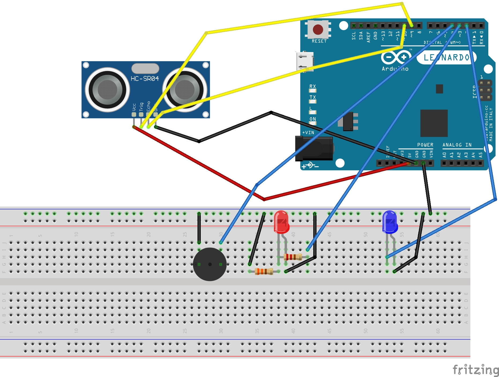

# Ultrasonic-Sensor-Detection
### Using a HC-SR04 Ultrasonic Sensor to determine distance and subsequently set of an alarm
+ Moving an object at most 30 inches in front of the Ultrasonic Sensor will cause the LEDs to start flicking and the Passive Buzzer to emit a sound. The rate of flickering and the voltage frequency of the buzzer depend on the distance the object is from the Ultrasonic Sensor:
  + 30-20 in. -> LEDs Flicker: Every Second, Buzzer Frequency: 500Hz
  + 20-10 in. -> LEDs Flicker: Every 3/4 Second, Buzzer Frequency 750Hz
  + 10-5 in. -> LEDs Flicker: Every 1/2 Second, Buzzer Frequency 1000Hz
  + 4-1 in. -> LEDs Flicker: Every 1/4 Second, Buzzer Frequency 1250Hz
### Wiring Diagram

### Disclaimer
My Arduino pins output a voltage of 3.3V which is why the Blue LED can be directly connected without resistors while the Red LED needs Voltage Division
### Credit
Instructed the wiring and the basics of the Ultrasonic Sensor: [Video](https://www.youtube.com/watch?v=n-gJ00GTsNg)
